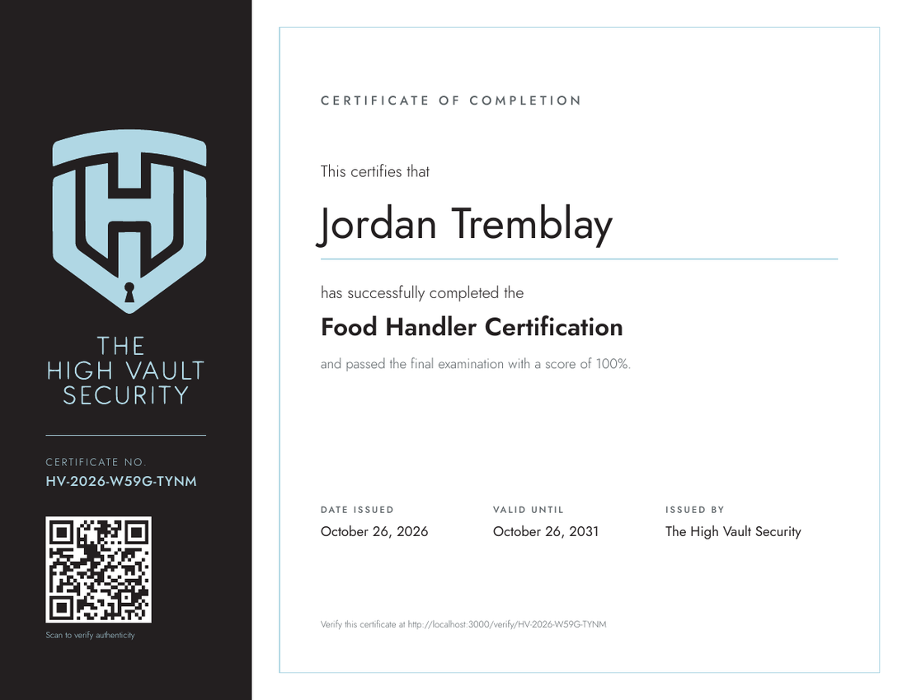
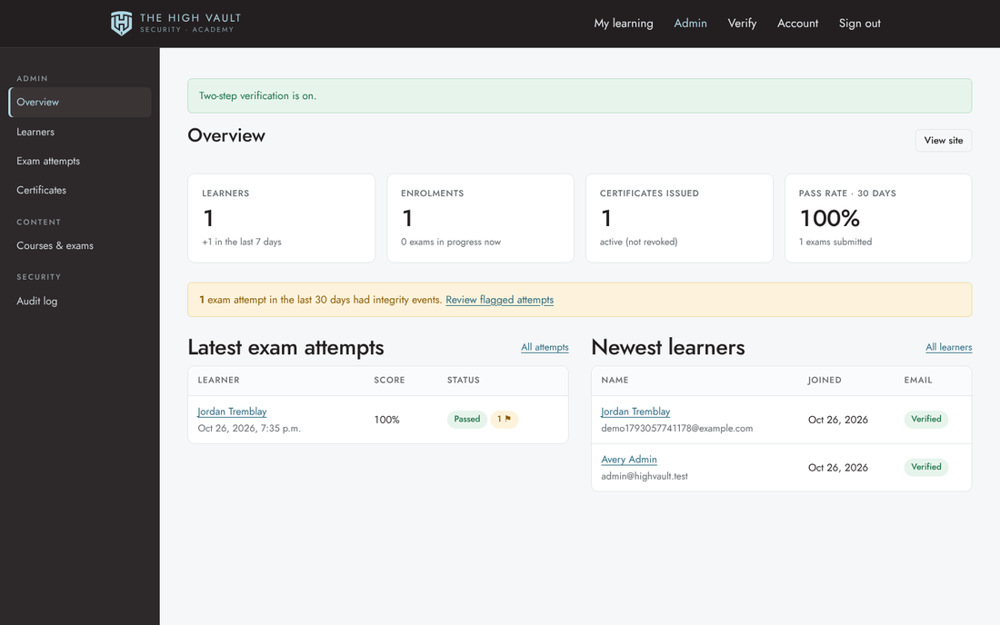

# The High Vault Security — Food Handler Certification

An online learning platform for The High Vault Security's food handler course. Learners create their own account, study the lessons, pass a proctored final exam and download a certificate that employers can verify. Administrators manage everything from a built-in dashboard.

**Stack:** Node.js 22 · Express 5 · PostgreSQL 16 · server-rendered EJS · no front-end framework. It's a small, auditable codebase that runs anywhere Docker or Node runs.

| Course page | Exam | Certificate | Admin |
|---|---|---|---|
|  |  |  |  |

---

## What's included

### For learners
- **Course page** laid out like a product page: price box, what you'll learn, how it works, course outline, exam and certificate details, FAQ.
- **Self-registration** with email verification, password reset and optional two-step verification (authenticator app).
- **Lesson player**: lessons unlock in order, progress saves automatically, and each lesson has a minimum study time tracked on the server.
- **Final exam**: questions drawn at random from a question bank, a live timer, autosave and a question navigator.
- **Results** with a score and a per-topic breakdown. Individual answers are never shown, so they can't leak.
- **PDF certificate** in the brand design, with a unique number (`HV-2026-XXXX-XXXX`) and a QR code.
- **Public verification page** (`/verify`): shows valid, expired or revoked.

### For administrators (`/admin`)
- **Overview**: learners, enrolments, certificates, 30-day pass rate, flagged exams.
- **Learners**: search; view progress, attempts, certificates and activity; verify an email; sign a user out everywhere; grant an extra attempt; enrol manually; correct a legal name; disable an account; promote to admin; reset 2-step.
- **Courses and exams**: edit the course page, price and exam rules; add, edit and reorder modules and lessons (Markdown plus YouTube/Vimeo video).
- **Question bank**: add and edit questions (single or multiple answer), retire questions, and **bulk-import from CSV**.
- **Exam attempts**: filter by flagged, live, passed, failed or voided. Each attempt shows every answer, the IP address, the browser and an integrity timeline. **Voiding** an attempt revokes its certificate.
- **Certificates**: search, revoke or reinstate, export to CSV.
- **Audit log** of sign-ins, admin changes and exam events.

---

## Anti-cheating measures

| Measure | How it works |
|---|---|
| Randomised exams | Each attempt draws questions at random from the bank, and answer options are shuffled per learner. A bank about twice the exam size makes shared answers much less useful. |
| Answer key never leaves the server | The browser receives only question text and option IDs. Grading happens server-side, and an automated test checks this. |
| Server-enforced time limit | Deadlines are stored in the database. Late answers are refused and expired attempts submit automatically. |
| Lessons before exam | The exam unlocks only when every lesson is complete. Minimum study time is credited from real elapsed server time, so sending requests rapidly doesn't add time. |
| Focus monitoring | Leaving the tab, leaving the window or exiting full screen gives a warning. After N warnings (configurable), the exam submits itself and is flagged. |
| Full-screen mode | Required where the device supports it (configurable). |
| Copy, paste, print, right-click | Blocked and logged. Text selection is disabled. |
| Personal watermark | The learner's name and email are tiled behind the exam, which discourages sharing screenshots. |
| One device at a time | Signing in on a second device signs out the first, which stops account sharing. |
| One open attempt | Enforced by a database constraint, so a second tab or a double-click can't start a second attempt. |
| Attempt limits and cooldown | Configurable maximum attempts and a waiting period between them. |
| Identity | The learner confirms their legal name at sign-up and at exam start. The name locks once a certificate is issued, and only an admin can correct it. |
| Forgery-proof certificates | Every certificate can be checked online by number or QR code, and revocation shows up immediately. |

**Limitation:** browser-based monitoring deters most cheating but can't stop a determined person with a second device. For a higher-stakes exam, add live or recorded webcam proctoring, or an in-person exam sitting.

---

## Security

- **Passwords**: Argon2id hashing, at least 12 characters, a common-password blocklist and an optional Have I Been Pwned check (k-anonymity, so the password never leaves the server).
- **Sign-in**: the account locks for 15 minutes after 5 failed attempts. Wrong MFA codes count toward the same limit. Login timing doesn't reveal whether an email exists, and neither does registration or password reset.
- **Two-step verification (TOTP)**: required for admins, optional for learners. Secrets are encrypted at rest with AES-256-GCM, and used codes can't be replayed.
- **Sessions**: stored server-side in Postgres. The cookie is `HttpOnly`, `Secure` and `SameSite=Lax`, with the `__Host-` prefix in production. The session ID changes at login, there's an 8-hour idle timeout, and changing or resetting a password signs out other sessions.
- **CSRF**: a synchronizer token on every form and API call.
- **Headers** (Helmet): a strict Content-Security-Policy (no inline scripts or styles, no third-party scripts), HSTS, `frame-ancestors 'none'`, `nosniff`, a referrer policy and a permissions policy.
- **Input**: every input is validated with zod. All SQL is parameterised. Admin-written Markdown is sanitised against an allow-list. The CSV export guards against formula injection.
- **Rate limits** on sign-in, registration, email sending, certificate lookups and exam API calls.
- **Least exposure**: the admin area returns 404 to anyone who isn't an admin. Nothing in the course content or question bank is publicly writable.
- **Audit trail** for authentication and every admin action.
- **Dependencies**: `npm audit` runs clean, and CI fails on high-severity advisories.

---

## Running it locally

Requirements: Node.js 22.12+ and PostgreSQL 14+.

```bash
npm install
cp .env.example .env            # then fill in SESSION_SECRET and ENCRYPTION_KEY (see comments in the file)
createdb highvault              # or point DATABASE_URL at any Postgres database
npm run seed                    # creates tables and loads the Food Handler course (7 modules, 14 lessons, 46 questions)
npm run create-admin -- you@yourdomain.ca "First" "Last"   # prints a one-time password
npm run dev                     # http://localhost:3000
```

Without `SMTP_URL`, verification and reset emails print to the server console.

The first time an admin signs in, they're asked to set up two-step verification before the dashboard opens.

### Tests

```bash
createdb highvault_test
cp .env .env.test               # set NODE_ENV=test and DATABASE_URL to the test database
npm test
```

The suite covers registration, verification, CSRF, the full learner journey through to a certificate, every anti-cheat rule, lockout, single-session enforcement, password reset, MFA (setup, sign-in and replay protection), admin access control, certificate revocation, CSV import and export, and XSS sanitisation.

---

## Deploying

The app is a single stateless container plus a PostgreSQL database.

```bash
docker compose up -d --build
docker compose exec app npm run seed
docker compose exec app npm run create-admin -- you@yourdomain.ca "First" "Last"
```

Any host that runs a container and managed Postgres works (Render, Railway, Fly.io, DigitalOcean App Platform, AWS, Azure). Checklist:

1. `NODE_ENV=production` and `APP_URL=https://your-domain`.
2. Generate fresh `SESSION_SECRET` and `ENCRYPTION_KEY` values. **Back up `ENCRYPTION_KEY`**: losing it means admins must re-enrol their two-step verification.
3. Set `TRUST_PROXY=1` (or the number of proxy hops) when behind a load balancer, so rate limits and logs see real client IPs.
4. Configure `SMTP_URL` with a transactional email provider (Postmark, SES, Mailgun, Resend…).
5. Serve over HTTPS only. The app sends HSTS in production.
6. Schedule daily database backups.
7. Optional: to charge for the course, set `STRIPE_SECRET_KEY` and `STRIPE_WEBHOOK_SECRET`, point a Stripe webhook at `https://your-domain/webhooks/stripe` (event `checkout.session.completed`), and set a price in Admin → Courses. Without Stripe, enrolment is free.

Rate-limit counters are kept in memory, which suits one app instance. If you run several instances, switch to a shared store (`rate-limit-postgresql` or Redis).

---

## Before going live: content checklist

- [ ] **Review the course content and question bank** with whoever is accountable for food safety training. The starter content follows Health Canada guidance and Ontario's Food Premises Regulation (O. Reg. 493/17), but provincial and municipal requirements vary.
- [ ] **Confirm recognition status.** If the course must be approved or recognised by a provincial program or local public health unit, get that confirmation first, then add it to the course page and FAQ. Until then, the FAQ deliberately tells learners to check with their employer or health unit.
- [ ] Set the price (Admin → Courses), support email (`SUPPORT_EMAIL`) and sending address (`MAIL_FROM`).
- [ ] Grow the question bank to at least about 60 questions (twice the 30-question exam) to reduce answer sharing.
- [ ] Have the privacy page (`views/public/privacy.ejs`) reviewed for your obligations under PIPEDA or provincial privacy law.

---

## Project layout

```
src/
  app.js              Express app: security headers, sessions, CSRF, routes
  server.js           Boots the app (runs migrations first)
  config.js           Validated environment configuration
  db/                 Pool, migrations, seed + starter course content
  lib/                Auth, exam engine, certificates (PDF), crypto, mail, validation
  routes/             public, auth, account, learn, exam, payments, admin
views/                EJS templates (public, auth, learn, admin, partials)
public/               CSS, client JS (exam engine, lesson timer), logo assets
test/                 End-to-end integration tests (node:test + supertest)
```
