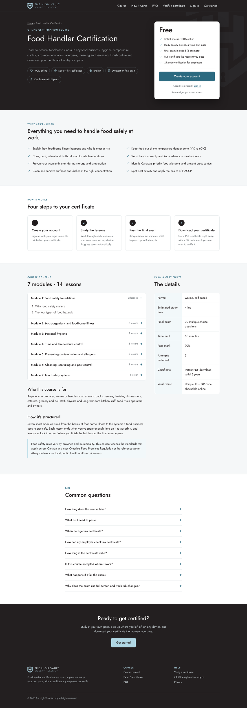
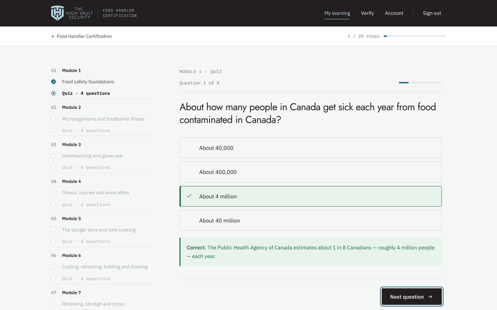
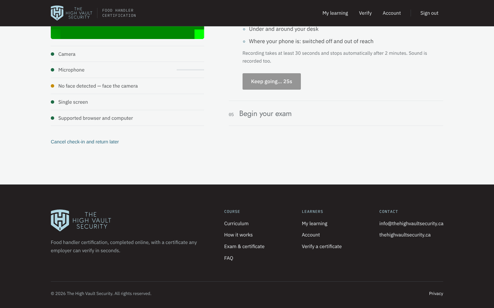
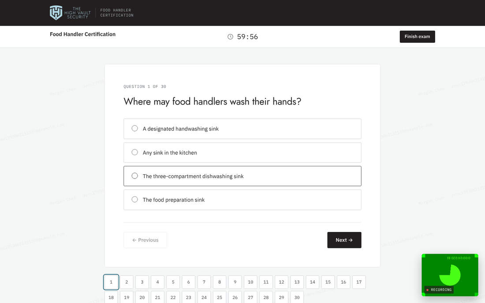
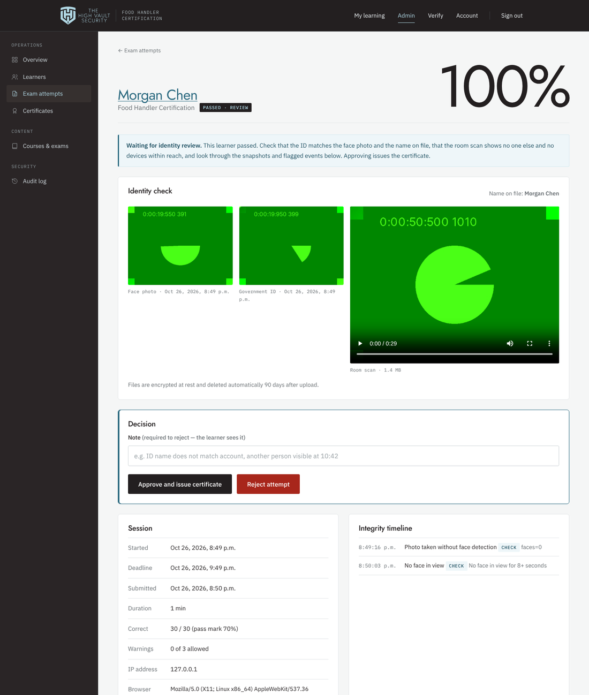

# The High Vault Security — Food Handler Certification

An online learning platform for The High Vault Security's food handler course. Learners create their own account and work through **10 modules, each a chapter (video and reading) followed by a quiz**. They then take a **proctored final exam** on camera with an ID check and a room scan, and receive a certificate employers can verify once the exam has been reviewed. Administrators manage everything from a built-in dashboard.

## Click-through preview

**https://avyam023-sketch.github.io/LMS-for-high-vault/**

These are the app's real pages, generated with fictional sample learners. There is no server behind them, so nothing you enter is saved. Use the bar at the bottom of the page to switch between the website, the learner area and the admin dashboard. The quizzes, the camera check-in and the timed exam all work.

The [`Preview site`](.github/workflows/pages.yml) workflow rebuilds it on every push (`node demo/build.js`, sample data in [`src/db/sample-data.js`](src/db/sample-data.js)). The preview includes the question bank and answers, as the admin pages do. Turn the workflow off once real exam questions are in use.

## Try it on your computer (5 minutes)

1. Install [Docker Desktop](https://www.docker.com/products/docker-desktop/) and open it.
2. Download this repo: **Code → Download ZIP**, then unzip it.
3. Open a terminal in the unzipped folder (on Windows: open the folder, click the address bar, type `cmd`, press Enter) and run:
   ```
   docker compose -f docker-compose.preview.yml up --build
   ```
4. When you see `listening on http://localhost:3000`, open **http://localhost:3000**.
   - Admin: `admin@example.com` / `vault-preview-2026`
   - Or click **Enrol now** and sign up as a learner (no email confirmation in the preview).
5. Stop with `Ctrl+C`. To wipe the preview data: `docker compose -f docker-compose.preview.yml down -v`

The preview turns off email confirmation and admin two-step verification and uses public placeholder keys, so it's only for your own computer. The app refuses to start in production with those keys.

---

## See it live: a working demo

**[DEMO.md](DEMO.md)** sets up a real, working copy of the site at a public address in about 30 minutes, for free: Render (site), Supabase in Canada (database), Resend (email) and Stripe test mode (payments). It walks through every click, then gives a 15-minute script for showing the client the whole flow, from registration with a 6-digit email code, through checkout, the proctored exam and admin review, to the certificate.

The demo starts with fictional sample learners so every admin screen has something in it. They use `@example.com` addresses, can't sign in and are never emailed. **Admin → Overview → Remove sample data** clears them.

## Production: AWS Lightsail in Montreal

For the real site, use [`deploy/aws/`](deploy/aws/README.md): one Lightsail server plus a managed PostgreSQL database in Canada (Montreal), automatic HTTPS with Caddy, and a verified TLS connection to the database. The guide walks through every click.

---

**Stack:** Node.js 22 · Express 5 · PostgreSQL 16 · server-rendered EJS · no front-end framework. It's a small, auditable codebase that runs anywhere Docker or Node runs.

| Course page | Module quiz | Exam check-in | Proctored exam | Identity review |
|---|---|---|---|---|
|  |  |  |  |  |

---

## What's included

### For learners
- **Course page** laid out like a product page: price box, what you'll learn, how it works, course outline, exam and certificate details, FAQ.
- **Self-registration** with email verification, password reset and optional two-step verification (authenticator app).
- **Course structure**: Module 1 → Chapter 1 → Module 1 quiz → Module 2 → … → Module 10 quiz → final exam. Everything unlocks strictly in order.
- **Chapters**: a video plus a written lesson, with a minimum study time tracked on the server. Videos are hosted on **Bunny Stream**. Each playback link is signed and expires after 6 hours, so it can't be shared. The learner must watch to the end (skipping ahead doesn't count) before continuing. A direct MP4/WebM link is tracked the same way. YouTube and Vimeo links play but can't be tracked.
- **Public site**: a crimson red and white design. All colours are set once as tokens at the top of `public/css/app.css` (`--brand`, `--tint`, `--accent`, …), so a palette change is a one-place edit. Errors and warnings use orange and amber so they never blend into the brand red.
  - The homepage shows real course screens on laptop and phone mockups.
  - Ten illustrated module cards, each with a summary that can be edited in Admin → Courses.
  - A *What you need* section and a pricing section ($89 CAD, one-time).
  - An About page, and a policies hub covering terms of use, terms of sale, refunds, exam and certificate rules, privacy (including cookies), accessibility, and copyright.
  - Exam rules and prices on the policy pages are read from the live course settings, so they always match.
- **Image slots**: six photo spots across the site. There are three "Who it's for" photos, a "Studying from home" photo on the homepage, one on the About page, and one on the sign-up panel. Admins manage them in **Admin → Site images**, where each slot shows where it appears, the best size and an idea for the shot. They can upload, replace or remove a photo and add a screen-reader description. Files are checked from their content (JPEG, PNG or WebP only, at least 1200 px wide, under 4 MB). An empty slot shows a branded placeholder, and admins see a label saying what belongs there.
- **Homepage motion**: built with GSAP and ScrollTrigger, self-hosted so the strict security policy stays intact.
  - The hero settles in on load and headlines rise into place.
  - A rail fills down the curriculum as you read.
  - *How it works* holds in place while its four steps play out.
  - The sample certificate tilts up to face the reader.
  - Visitors who ask their device for reduced motion get the same page without movement, and everything is visible without JavaScript.
- **Sign-up as cards**: one question per card (name, email, password, confirm). Each card is checked before moving on, with a password-strength meter and a review card before submitting. The next cards peek out from behind. Without JavaScript it falls back to a single form, and the server checks everything again.
- **Reference codes on everything**: every account gets a learner ID (`HV-L-7K3M-Q9TX`), every exam attempt an exam reference (`HV-E-…`), every payment a payment reference (`HV-P-…`), and every certificate a certificate number (`HV-2026-…`). They appear on the learner's screens and in every email. Admins can paste any of them into the *Find* box to jump straight to the record. The alphabet leaves out look-alike characters (0/O, 1/I/L) so codes can be read over the phone.
- **Automatic emails** (sent through Resend): email confirmation, welcome with learner ID, enrolment/payment confirmation, exam result (passed and in review, passed with certificate, or not passed with attempts left and the retake time), certificate issued, review rejected, attempt voided, certificate revoked, extra attempt granted, certificate expiring in 60 days, security alerts, and a *new exam to review* alert for staff. Each one has an idempotency key, so a retry never sends a duplicate.
- **Module quizzes**: not timed or monitored. The learner must answer each question correctly to move on. A wrong answer is marked and they try again; a correct answer shows the explanation.
- **Proctored final exam**: a check-in before the timer starts (system check, face photo, ID photo, room-scan video). The camera and microphone stay on throughout, with snapshots, face monitoring, one-screen enforcement, full screen and focus monitoring. Questions are drawn at random, with autosave and a navigator.
- **Results** with a score and a per-topic breakdown. Individual answers are never shown, so they can't leak. A passed, proctored exam shows "certificate pending review" until an admin approves it.
- **PDF certificate** in the brand design, with a unique number (`HV-2026-XXXX-XXXX`) and a QR code.
- **Public verification page** (`/verify`): shows valid, expired or revoked.

### Privacy tools for learners
- **Download my data** (JSON) and **Delete my account** on the account page. Deletion erases the profile, progress and exam recordings; issued certificates stay verifiable until they expire.
- Terms of use and privacy policy pages, linked from sign-up and the footer.

### For administrators (`/admin`)
- **Overview**: learners, enrolments, certificates, 30-day pass rate, flagged exams, and exams waiting for identity review.
- **Identity review queue**: for each passed exam, the face photo and ID side by side with the name on file, the room-scan video, all snapshots (flagged moments highlighted) and the integrity timeline. **Approve** issues the certificate and emails the learner; **reject** voids the attempt and emails the reason.
- **Learners**: search; view progress, attempts, certificates and activity; verify an email; sign a user out everywhere; grant an extra attempt; enrol manually; correct a legal name; disable an account; promote to admin; reset 2-step.
- **Courses and exams**: edit the course page, price, exam rules and proctoring settings; add, edit and reorder modules and chapters (Markdown plus a video link).
- **Questions**: two banks — the **final-exam bank** (drawn at random) and **module quizzes** (fixed order, with explanations). Single or multiple answer, retire questions, **bulk-import from CSV** into either.
- **Exam attempts**: filter by flagged, live, passed, failed or voided. Each attempt shows every answer, the IP address, the browser and an integrity timeline. **Voiding** an attempt revokes its certificate.
- **Certificates**: search, revoke or reinstate, export to CSV.
- **Audit log** of sign-ins, admin changes, exam events and every view of ID evidence.
- **Roles**: *admin* (everything) and *identity reviewer* (review queue only). Both require two-step verification.
- **Automatic emails**: certificate ready, exam rejected, certificate expiring in 60 days (sent once).

### Search and sharing
- Social share card (Open Graph/Twitter), Course structured data for search engines, `sitemap.xml`, `robots.txt` (private areas excluded), app icons and a web manifest.

---

## Anti-cheating measures

| Measure | How it works |
|---|---|
| Randomised exams | Each attempt draws questions at random from the bank, and answer options are shuffled per learner. A bank about twice the exam size makes shared answers much less useful. |
| Answer key never leaves the server | The browser receives only question text and option IDs. Grading happens server-side, and an automated test checks this. |
| Server-enforced time limit | Deadlines are stored in the database. Late answers are refused and expired attempts submit automatically. |
| Course before exam | The exam unlocks only when every chapter and module quiz is complete. Minimum study time is credited from real elapsed server time, so sending requests rapidly doesn't add time. |
| ID and face check | Before the exam, the learner photographs their face and holds government ID up to the camera. A reviewer compares both with the name on the account before any certificate is issued. |
| Room scan | A recorded video of at least 30 seconds, with sound: all walls, the desk, under the desk, and where the phone is. |
| Camera on throughout | The camera and microphone must stay on. Turning the camera off is a warning and blocks the exam until it's back. Snapshots are taken every 30 seconds and at every flagged moment. |
| No one else present | Self-hosted face detection runs in the browser and flags "no face for 8+ seconds" and "more than one person". Sustained talking or noise is flagged too. These go to the reviewer with snapshots and **don't** end the exam automatically, because lighting or a poster can fool detection. |
| One screen, a real computer | A second monitor blocks check-in and counts as a warning mid-exam (detected in Chrome and Edge, which the exam requires). Phones and tablets can't take the exam. |
| Human review | With identity review on (the default), certificates are issued only after an admin approves the recording. |
| Focus monitoring | Leaving the tab, leaving the window, exiting full screen, turning off the camera or connecting a second screen gives a warning. After N warnings (configurable), the exam submits itself and is flagged. |
| Full-screen mode | Required where the device supports it (configurable). |
| Copy, paste, print, right-click | Blocked and logged. Text selection is disabled. |
| Personal watermark | The learner's name and email are tiled behind the exam, which discourages sharing screenshots. |
| One device at a time | Signing in on a second device signs out the first, which stops account sharing. |
| One open attempt | Enforced by a database constraint, so a second tab or a double-click can't start a second attempt. |
| Attempt limits and cooldown | Configurable maximum attempts and a waiting period between them. |
| Identity | The learner confirms their legal name at sign-up and at exam start. The name locks once a certificate is issued, and only an admin can correct it. |
| Forgery-proof certificates | Every certificate can be checked online by number or QR code, and revocation shows up immediately. |

**Limitations, stated plainly:**
- Proctoring is recorded and reviewed afterwards, not watched live. A determined person could still use a device the camera can't see; the room scan, snapshots and human review make that hard, not impossible. Live remote proctoring would close the gap further.
- "Phones out of reach" and "quiet room" are confirmed by the learner's pledge and checked by the reviewer against the room scan. Software can't verify them directly.
- Face detection is a signal for the reviewer, not a verdict.

---

## Security

- **Passwords**: Argon2id hashing, at least 12 characters, a common-password blocklist and an optional Have I Been Pwned check (k-anonymity, so the password never leaves the server).
- **Sign-in**: the account locks for 15 minutes after 5 failed attempts. Wrong MFA codes count toward the same limit. Login timing doesn't reveal whether an email exists, and neither does registration or password reset.
- **Two-step verification (TOTP)**: required for admins, optional for learners. Secrets are encrypted at rest with AES-256-GCM, and used codes can't be replayed.
- **Sessions**: stored server-side in Postgres. The cookie is `HttpOnly`, `Secure` and `SameSite=Lax`, with the `__Host-` prefix in production. The session ID changes at login. Sessions end after 8 hours idle, and after 12 hours (staff) or 7 days (learners) no matter what. Changing or resetting a password, or changing someone's role, signs out their other sessions.
- **Security alerts**: learners are emailed when their password, two-step verification or staff access changes.
- **CSRF**: a synchronizer token on every form and API call, plus a check that refuses cross-site requests (`Origin` / `Sec-Fetch-Site`).
- **HTTPS only** in production (redirect + HSTS preload). Signed-in pages are sent with `Cache-Control: no-store` so shared computers don't keep copies.
- **Headers** (Helmet): a strict Content-Security-Policy (no inline scripts or styles, no third-party scripts), HSTS, `frame-ancestors 'none'`, `nosniff`, a referrer policy and a permissions policy.
- **Input**: every input is validated with zod. All SQL is parameterised. Admin-written Markdown is sanitised against an allow-list. The CSV export guards against formula injection.
- **Rate limits** on sign-in, registration, email sending, password and account changes, certificate lookups and exam API calls. Counters live in Postgres, so they hold across restarts and multiple servers.
- **Bot protection** on sign-up: a hidden honeypot field and a minimum fill time, without a third-party CAPTCHA.
- **Database**: 15-second statement timeout and idle-transaction timeout, so one bad query can't take the site down.
- **Operations**: request IDs on every response, a one-line access log with tokens redacted, `/healthz` for the platform's health checks.
- **ID photos and exam recordings**:
  - Checked by file signature on upload, then encrypted with AES-256-GCM before they reach the database.
  - Each file's ciphertext is bound to its exam and file type (authenticated data), so a copied row won't decrypt; each purpose (ID evidence, MFA secrets) uses its own HKDF-derived key.
  - Visible only to staff. **Identity reviewers** see the review queue and evidence and nothing else; every view is written to the audit log.
  - Deleted automatically 30 days after a decision (`PROCTOR_RETENTION_AFTER_DECISION_DAYS`) and never kept past 90 days (`PROCTOR_RETENTION_DAYS`). Admins can delete an attempt's evidence immediately.
  - Face detection runs in the browser with a self-hosted model: no images go to any third party. Camera and microphone are allowed only on this site.
- **Key rotation**: put the old key in `ENCRYPTION_KEYS_PREVIOUS`, set a new `ENCRYPTION_KEY`, deploy, run `npm run rotate-keys`, then remove the old key.
- **Least exposure**: the admin area returns 404 to anyone who isn't an admin. Nothing in the course content or question bank is publicly writable.
- **Audit trail** for authentication and every admin action.
- **Dependencies**: `npm audit` runs clean, CI fails on high-severity advisories, Dependabot opens weekly update PRs, and CodeQL scans the code (once the repo is public or has GitHub Advanced Security).
- **Disclosure**: `/.well-known/security.txt` tells researchers how to report a vulnerability.

---

## Running it locally

Requirements: Node.js 22.12+ and PostgreSQL 14+.

```bash
npm install
cp .env.example .env            # then fill in SESSION_SECRET and ENCRYPTION_KEY (see comments in the file)
createdb highvault              # or point DATABASE_URL at any Postgres database
npm run seed                    # creates tables and loads the course: 10 modules, 10 chapters, 40 quiz questions, 46 exam questions
npm run create-admin -- you@yourdomain.ca "First" "Last"   # prints a one-time password
npm run dev                     # http://localhost:3000
```

Without `RESEND_API_KEY` or `SMTP_URL`, verification and reset emails print to the server console.

The first time an admin signs in, they're asked to set up two-step verification before the dashboard opens.

### Tests

```bash
createdb highvault_test
cp .env .env.test               # set NODE_ENV=test and DATABASE_URL to the test database
npm test
```

`test/security.test.js` covers encryption binding and tampering, cross-site request refusal, no-store caching, the sign-up bot trap, absolute session lifetime, security alert emails, reviewer least-privilege and evidence-view logging, evidence retention, data export and account deletion, expiry reminders, and the site essentials. The main suite covers registration, verification, CSRF, the full learner journey through to a certificate, module quizzes (answer-until-correct, no skipping, unlock order), proctored check-in (required media, upload validation, encryption at rest, timer starting only at "begin", lapsed and cancelled check-ins), identity review, every anti-cheat rule, lockout, single-session enforcement, password reset, MFA (setup, sign-in and replay protection), admin access control, certificate revocation, CSV import and export, and XSS sanitisation.

---

## Deploying

The app is a single stateless container plus a PostgreSQL database.

```bash
docker compose up -d --build
docker compose exec app npm run seed
docker compose exec app npm run create-admin -- you@yourdomain.ca "First" "Last"
```

Any host that runs a container and managed Postgres works (Render, Railway, Fly.io, DigitalOcean App Platform, AWS, Azure). Checklist:

1. `NODE_ENV=production` and `APP_URL=https://your-domain`.
2. Generate fresh `SESSION_SECRET` and `ENCRYPTION_KEY` values. **Back up `ENCRYPTION_KEY`**: losing it means admins must re-enrol their two-step verification.
3. Set `TRUST_PROXY=1` (or the number of proxy hops) when behind a load balancer, so rate limits and logs see real client IPs.
4. Set `RESEND_API_KEY` (verify your sending domain in Resend first, and set `MAIL_FROM` to an address on it). Any SMTP provider also works via `SMTP_URL`. Set `BUNNY_STREAM_TOKEN_KEY` from your Bunny Stream library's security settings.
5. Serve over HTTPS only. The app sends HSTS in production.
6. Schedule daily database backups. Proctoring files live in the database, so allow roughly 2 MB per exam (deleted after the retention period).
7. To charge for the course, set `STRIPE_SECRET_KEY` and `STRIPE_WEBHOOK_SECRET`, and point a Stripe webhook at `https://your-domain/webhooks/stripe` with events `checkout.session.completed`, `checkout.session.async_payment_succeeded`, `checkout.session.async_payment_failed`, `checkout.session.expired` and `charge.refunded`. Learners are enrolled as soon as they return from checkout; the webhook covers slow payment methods and records refunds (a full refund ends access). Set `STRIPE_AUTOMATIC_TAX=true` after turning on Stripe Tax. The price is set in Admin → Courses.
8. Managed databases with their own certificate authority: set `DATABASE_CA_FILE` to the CA file (AWS RDS and Lightsail; `deploy/aws/setup.sh` downloads it) or paste the certificate into `DATABASE_CA_CERT` (Supabase). The connection is always verified. On Supabase, the app also locks every table away from Supabase's public Data API roles.

Rate-limit counters are kept in memory, which suits one app instance. If you run several instances, switch to a shared store (`rate-limit-postgresql` or Redis).

---

## Before going live: content checklist

- [ ] **Review the course content and question bank** with whoever is accountable for food safety training. The starter content follows Health Canada guidance and Ontario's Food Premises Regulation (O. Reg. 493/17), but provincial and municipal requirements vary.
- [ ] **Confirm recognition status.** If the course must be approved or recognised by a provincial program or local public health unit, get that confirmation first, then add it to the course page and FAQ. Until then, the FAQ deliberately tells learners to check with their employer or health unit.
- [ ] **Connect Stripe** (`STRIPE_SECRET_KEY`, `STRIPE_WEBHOOK_SECRET`). The course is priced at $89 CAD. Until Stripe is connected, *Register* still works but enrolling is refused with a polite message, so nobody gets the paid course for free.
- [ ] If the business is registered for GST/HST, turn on Stripe Tax and set `STRIPE_AUTOMATIC_TAX=true` so tax is added at checkout. The terms of sale say taxes are added where required.
- [ ] **Remove the sample data** (Admin → Overview) and set `SEED_SAMPLE_DATA=false`.
- [ ] Set the support email (`SUPPORT_EMAIL`) and sending address (`MAIL_FROM`). The price can be changed in Admin → Courses.
- [ ] **Add the 10 chapter videos.**
  1. Upload them to a Bunny Stream library.
  2. In the library's Security settings, turn on *Embed view token authentication* and copy the key into `BUNNY_STREAM_TOKEN_KEY`.
  3. Add your domain under *Allowed domains*.
  4. For each chapter, paste the video's embed link (`https://iframe.mediadelivery.net/embed/<library>/<video>`) into Admin → Courses → the chapter → *Chapter video*.
- [ ] Grow the final-exam bank to at least about 60 questions (twice the 30-question exam) to reduce answer sharing.
- [ ] Decide who reviews exam recordings. The policies promise reviews "usually within two business days" and replies to refund and accessibility emails within two business days.
- [ ] **Have a lawyer review the policy pages** in `views/public/policies/`: terms of use, terms of sale, refund policy, exam and certificate policy, privacy, accessibility, and copyright. Confirm the defaults:
  - **Governing law:** Ontario.
  - **Refunds:** a full refund within 14 days if the final exam hasn't been started.
  - **Appeals:** within 14 days.
  - **Data residency:** the privacy policy says learner data is stored in Canada, which is true once the app is hosted in AWS Canada (Montreal). Update `POLICIES_UPDATED` in `src/lib/policies.js` whenever the wording changes.
- [ ] Have the privacy page (`views/public/policies/privacy.ejs`) and the exam recording consent reviewed for your obligations under PIPEDA or provincial privacy law. **Collecting ID images and room video is sensitive.** Confirm the retention period and who may access recordings.

---

## Project layout

```
src/
  app.js              Express app: security headers, sessions, CSRF, routes
  server.js           Boots the app (runs migrations first)
  config.js           Validated environment configuration
  db/                 Pool, migrations, seed + starter course content
  lib/                Auth, exam engine, certificates (PDF), crypto, mail, validation
  routes/             public, auth, account, learn, exam, payments, admin
views/                EJS templates (public, auth, learn, admin, partials)
public/               CSS, client JS (exam engine, lesson timer), logo assets
test/                 End-to-end integration tests (node:test + supertest)
```
