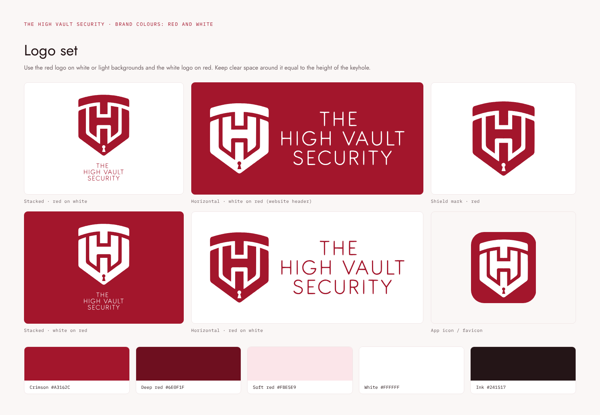

# The High Vault Security: logo pack (red and white)

| File | Use it for |
|---|---|
| `svg/logo-stacked-red.svg`, `png/logo-stacked-red.png` | Main logo on white or light backgrounds: documents, certificates, signage |
| `svg/logo-stacked-white.svg`, `png/logo-stacked-white.png` | Main logo on red or dark backgrounds |
| `svg/logo-stacked-on-red.svg`, `png/logo-stacked-on-red.png` | Logo with its own red background: social profile images, slides |
| `svg/logo-horizontal-red.svg`, `png/logo-horizontal-red.png` | Wide spaces on white: email signatures, letterheads |
| `svg/logo-horizontal-white.svg`, `png/logo-horizontal-white.png` | Wide spaces on red: the website header and footer |
| `svg/logo-mark-red.svg`, `svg/logo-mark-white.svg` | The shield on its own, where the name already appears nearby |
| `svg/app-icon.svg`, `png/app-icon.png` | App icon, favicon, social avatar |

**Colours:** crimson `#A3162C`, deep red `#6E0F1F`, soft red `#FBE5E9`, white `#FFFFFF`, ink `#241517`.

**Rules:**
- Use the SVG files wherever possible. They stay sharp at any size.
- The PNGs have transparent backgrounds and are large enough for print.
- Keep clear space around the logo at least the height of the keyhole.
- Don't stretch, recolour or add effects to the logo.
